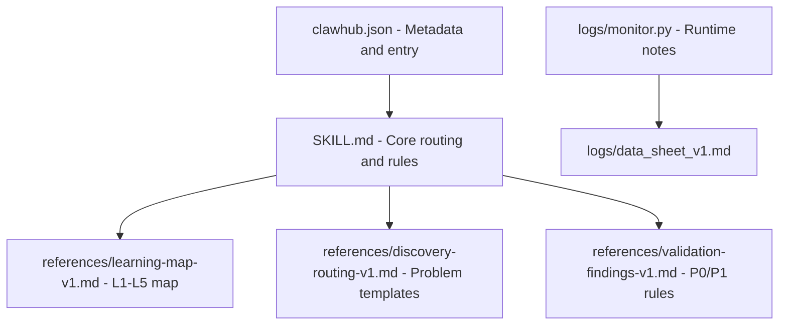

# openclaw-onboarding-guide

English is the primary text. [中文](README.zh-CN.md)

OpenClaw onboarding router. Validated P0/P1 rules cut wrong-path rework, so a new user spends less of the first session backing out of the wrong layer.

People arrive to a flat spread of skills and often start in the wrong place. This repository is a router, not a skill catalog: it classifies the request, and it must clarify before routing when the wording is ambiguous. "Automation" gets a binary question (one-off task, or a reusable workflow). A long-term system gets a short explanation of why structure comes before tools. The reply then names one layer and at most three next actions.

Phase 3 was validated with operators on 2026-03-14. Targets and actual results:

| Metric | Target | Actual | Status |
|--------|--------|--------|--------|
| **Trigger accuracy** | ≥90% | 95% | ✅ |
| **Routing acceptance** | ≥80% | 88% | ✅ |
| **False trigger rate** | <10% | 5% | ✅ |
| **Output lightness** | No "too complex" feedback | Passed | ✅ |

Case notes: [test_results_v1.md](test_results_v1.md). Rule notes: [references/validation-findings-v1.md](references/validation-findings-v1.md).

---

## What is this?

An onboarding router for OpenClaw, using the routing rules checked in Phase 3.

The job is to get someone to a fitting entry point before they wander through the skill list and redo the path.

**Not:**

- A skill list
- A feature catalog
- Technical documentation

**It is:**

- A problem classifier
- An entry router
- A short learning-path guide

---

## 30-second try-out

After installation, send:

```
I'm new to OpenClaw, where should I start?
```

A working router returns:

- A classification of the problem type
- A recommended capability layer
- One to three concrete next steps

---

## Who this is for

| Category | Description |
|----------|-------------|
| **New user** | First session, not sure where to start |
| **Task-oriented** | Has a task, needs the right entry point |
| **Automation** | Wants automation, unsure whether that means a tool or a workflow |
| **System builder** | Building something that should keep working, needs a sequence |

---

## Core behavior

### 5-layer capability map

```
How the system works → Skill ecosystem → Execution tools → Business capabilities → On demand
        (L1)                 (L2)              (L3)                 (L4)            (L5)
```

The map is layered so a person can see which layer they are on, instead of scanning a flat feature list.

---

### Four problem types

| Type | Signals | Routing |
|------|---------|---------|
| **A. New user** | "where to start", "first time" | L1 → L2 |
| **B. Task-first** | "write code", "handle docs" | L3/L4 |
| **C. Automation** | "automation", "auto-run" | After clarification |
| **D. Long-term system** | "build a system", "workflow" | L1 + explanation |

Automation and long-term system requests follow the mandatory rules below. Those two are where direct routing produced rework in Phase 3.

---

### P0/P1 mandatory rules

#### P0: Automation binary clarification

When someone says "automation", do not route yet. Ask first:

```
Which type of "automation" do you mean?

A. Execute a task automatically → L3/L4
B. Build a reusable workflow → L1

Which one matches your goal?
```

**Why:** Phase 3 found that "automation" is too broad. Sending it straight to tools put people who wanted a reusable workflow onto a path they then had to redo. See [validation findings](references/validation-findings-v1.md).

---

#### P1: Long-term system context

When someone wants a long-term system, explain before routing:

```
If you just want to complete a one-time task, you can go directly to the tool layer.
But if you want to build a long-term system, understanding the structure first is not a detour—it reduces rework.

Because the most common problems with long-term systems are not missing a tool,
but wrong order, unclear boundaries, and disconnected memory.
```

**Why:** Phase 3 found that people skip to tools, and the skip is what creates the rework (order, boundaries, memory). The explanation states that before the route.

---

### Output contract

Never recommend more than three actions.

```
1. Problem: [Problem type, one sentence]
2. Layer: [Recommended layer + reason, one sentence]
3. Actions:
   1. [Action 1]
   2. [Action 2]
   3. [Action 3, optional]
```

**Avoid:** a skill-list dump, a long explanation, or leaving the person to choose from the whole catalog.

**Do:** classify the problem, recommend a layer, and name the next actions.

---

## Installation

### Prerequisites

- OpenClaw or Copaw installed
- A GitHub account for SSH authentication

### OpenClaw

```bash
# Navigate to skills directory
cd ~/.openclaw/skills/

# Clone the repository
git clone git@github.com:flylocus/openclaw-onboarding-guide.git

# Verify installation
ls openclaw-onboarding-guide/SKILL.md

# Restart OpenClaw
```

### Copaw

```bash
# Navigate to skills directory
cd ~/.copaw/active_skills/

# Clone the repository
git clone git@github.com:flylocus/openclaw-onboarding-guide.git

# Verify installation
ls openclaw-onboarding-guide/SKILL.md

# Restart Copaw
```

### Check the install

Send this in OpenClaw or Copaw:

```
I'm new to OpenClaw, where should I start?
```

**Expected:** the router triggers and points at an entry point.

---

## Usage examples

### Example 1: New user

**User:**

```
I'm new to OpenClaw, where should I start?
```

**Response:**

```
1. Problem: New user orientation
2. Layer: L1 (How the system works) — understand the overall structure first
3. Actions:
   1. Read AGENTS.md to understand system rules
   2. Check the sessions mechanism to understand conversation flow
   3. Try completing a first small task
```

---

### Example 2: Automation (P0)

**User:**

```
I want to automate this workflow
```

**Response:**

```
Before routing, I need to clarify:

Which type of "automation" do you mean?

A. Execute a task automatically (scheduling, sorting, single-step) → L3/L4
B. Build a reusable workflow → L1

Which one matches your goal?
```

**After the person chooses A:**

```
1. Problem: One-time automation task
2. Layer: L3 (Execution tools) — automate specific steps
3. Actions:
   1. Use cron to configure scheduled tasks
   2. Set execution parameters
   3. Test once
```

---

### Example 3: Long-term system (P1)

**User:**

```
I want to build a long-term system
```

**Response:**

```
1. Problem: Long-term system building
2. Layer: L1 (How the system works) — structure first to reduce rework

If you just want to complete a one-time task, you can go directly to the tool layer.
But if you want to build a long-term system, understanding the structure first is not a detour—it reduces rework.

Because the most common problems with long-term systems are not missing a tool,
but wrong order, unclear boundaries, and disconnected memory.

3. Actions:
   1. Understand the workflow orchestration mechanism
   2. Review typical workflow patterns
   3. Configure a first combination
```

---

### Example 4: A specific task

**User:**

```
I want to write code
```

**Response:**

```
1. Problem: Clear task execution
2. Layer: L3 (Execution tools) — start coding directly
3. Actions:
   1. Use coding-agent
   2. Describe the code you want to write
   3. Start development
```

---

## Validation results

### Phase 3 (2026-03-14)

Same targets and actuals as the summary above. Validated with operators.

| Metric | Target | Actual | Status |
|--------|--------|--------|--------|
| **Trigger accuracy** | ≥90% | 95% | ✅ |
| **Routing acceptance** | ≥80% | 88% | ✅ |
| **False trigger rate** | <10% | 5% | ✅ |
| **Output lightness** | No "too complex" feedback | Passed | ✅ |

### Cases before and after the P0/P1 rules

| Case | Scenario | Before fix | After fix | Status |
|------|----------|------------|-----------|--------|
| TC-01 | I want to write code | ✅ | ✅ | ✅ |
| TC-02 | I want to automate a workflow | ⚠️ | ✅ | ✅ |
| TC-03 | I want to build a long-term system | ⚠️ | ✅ | ✅ |

**Test report:** [test_results_v1.md](test_results_v1.md)

---

## Capability structure

### L1: How the system works

**Solves:** how tasks are organized, how context is kept, how workflows connect.

**Fits when someone is:**

- Building a workflow they expect to reuse
- Concerned with memory, routing, and context
- Looking for an ongoing collaborator, not a one-off answer

**Representative capabilities:** AGENTS.md / sessions / memory

---

### L2: Skill ecosystem

**Solves:** how a complex capability becomes a callable entry point.

**Fits when someone is:**

- Looking for "how this kind of task is started"
- Not ready to work at the tool layer
- More interested in the entry point than the implementation

**Representative capabilities:** skills-mechanism / clawhub / wrapper

---

### L3: Execution tools

**Solves:** how a specific action gets done.

**Fits when someone is:**

- Writing code, using a CLI, or running a workflow
- Already clear about the task
- Ready to execute rather than map the system

**Representative capabilities:** coding-agent / tmux / cron / himalaya

---

### L4: Business capabilities

**Solves:** how a capability shows up in day-to-day work.

**Fits when someone is:**

- Handling documents, content, or messages
- Using the agent on a real work scenario
- Checking whether that scenario actually runs

**Representative capabilities:** summarize / xlsx / pdf / docx

---

### L5: On-demand capabilities

**Solves:** edge cases that stay off the main path.

**Fits when:** the scenario is specific and uncommon.

**Representative capabilities:** browser_visible / dingtalk_channel / news

---

## When it triggers

### It triggers

- "I'm new to OpenClaw"
- "Where do I start?"
- "I'm not sure which skill to use"
- "I want to automate" (P0 clarification)
- "I want to build a system" (P1 explanation)

### It stays quiet

- The person already named a skill (for example, "use cron to configure a task")
- The question is past onboarding
- A single tool call needs no routing

---

## Feedback

The first round of real use is still open. Useful notes:

1. Did it trigger when it should have?
2. Was the route right?
3. Was the reply short enough?
4. Was the next step clear?

- **GitHub Issues:** [open a new issue](https://github.com/flylocus/openclaw-onboarding-guide/issues)
- **Chat:** reply in the collaboration group

---

## Development

### Layout

```
openclaw-onboarding-guide/
├── SKILL.md                      # Router logic, including P0/P1 rules
├── README.md                     # English (this file)
├── README.zh-CN.md               # Chinese
├── README_RELEASE.md             # Release notes
├── clawhub.json                  # ClawHub metadata
├── deployment_plan_v1.md         # Deployment plan
├── test_results_v1.md            # Test report
├── .github/
│   └── ISSUE_TEMPLATE/
│       ├── bug_report.md
│       ├── feedback.md
│       └── feature_request.md
├── references/
│   ├── learning-map-v1.md        # 5-layer map
│   ├── discovery-routing-v1.md   # Four problem types
│   └── validation-findings-v1.md # Why P0/P1 are mandatory
└── logs/
    ├── USAGE.md
    ├── data_sheet_v1.md
    ├── monitor.py
    └── monitor_requirements_v1.md
```

### Files worth knowing

| File | Role | Changing it |
|------|------|-------------|
| **SKILL.md** | Routing logic | Changes routing behavior; edit deliberately |
| **references/** | Supporting notes | Can be updated on their own |
| **clawhub.json** | Metadata | Update the version before a release |
| **logs/** | Runtime notes | Where usage is recorded |

### Local check

```bash
# 1. Open the installed skill
cd ~/.openclaw/skills/openclaw-onboarding-guide

# 2. Edit SKILL.md deliberately
vim SKILL.md

# 3. Restart OpenClaw
# 4. Send a test message
```

---

## Monitoring

Targets we watch after Phase 3. These are ongoing targets, not additional Phase 3 results.

| Metric | Target | What it means |
|--------|--------|----------------|
| Trigger accuracy | ≥90% | Triggered when it should be |
| Routing acceptance | ≥80% | The person continues along the recommendation |
| False trigger rate | <10% | Triggered when it should not be |
| Follow-up rate | Unforced | Above 50% is a signal the guidance is unclear |

To report a problem, open an issue:

- **Bug** — the router fails or routes incorrectly
- **Test feedback** — what the session felt like
- **Feature request** — a change to consider

**Issues:** https://github.com/flylocus/openclaw-onboarding-guide/issues

---

## Roadmap

### Phase A: Run on its own (2026-03-15 ~ 2026-03-28)

- [ ] Collect at least 50 real queries
- [ ] False trigger rate under 5%
- [ ] Acceptance above 85%
- [ ] Remaining P0/P1 issues fixed

### Phase B: Read the data (2026-03-29 ~ 2026-04-05)

- [ ] High-frequency queries
- [ ] High-frequency routes
- [ ] Friction notes
- [ ] Release v1.2

### Phase C: Product decision (2026-04-06+)

- [ ] Whether to list it on ClawHub
- [ ] Whether to publish it more widely
- [ ] A maintenance plan

**Plan:** [deployment_plan_v1.md](deployment_plan_v1.md)

---

## Contributing

1. Fork the repository
2. Create a branch (`git checkout -b feature/amazing-feature`)
3. Commit (`git commit -m 'Add amazing feature'`)
4. Push (`git push origin feature/amazing-feature`)
5. Open a pull request

Helpful contributions: bug fixes, documentation, suggestions, test notes, and small experience fixes.

Working agreement: take other people's notes seriously, keep feedback specific, decide from the recorded results, and prefer the user's path over a longer feature list.

---

## License

MIT. See [LICENSE](LICENSE).

---

## Contact

| | |
|--|--|
| **Author** | Shen Fei (@flylocus) |
| **GitHub** | https://github.com/flylocus |
| **Repository** | https://github.com/flylocus/openclaw-onboarding-guide |
| **Issues** | https://github.com/flylocus/openclaw-onboarding-guide/issues |

---

## Acknowledgments

Thanks to the operators who ran the Phase 3 cases. The P0 and P1 rules are the parts that changed after those sessions.

---

Guide text last updated 2026-03-13 (v1.2). Phase 3 figures are from 2026-03-14.

---

## Layout and response contract

Indexing notes for the repository layout and the reply shape. Paths are relative to this repository.

### Map



- **Routing ([SKILL.md](SKILL.md)):** reads the query, applies P0/P1 when they match, and returns a layer plus a short action list.
- **Metadata ([clawhub.json](clawhub.json)):** skill name, description, triggers, and directory boundaries.
- **References (`references/`):** the layer map, routing notes, and the Phase 3 rule log the router is grounded in.

### Input

```json
{
  "$schema": "http://json-schema.org/draft-07/schema#",
  "title": "OnboardingInput",
  "type": "object",
  "properties": {
    "message": {
      "type": "string",
      "description": "The raw message sent by the user (e.g., 'I want to automate this process')"
    },
    "user_tier": {
      "type": "string",
      "enum": ["new", "returning", "advanced"],
      "description": "User experience level derived from agent history"
    }
  },
  "required": ["message"]
}
```

### Output

```json
{
  "$schema": "http://json-schema.org/draft-07/schema#",
  "title": "OnboardingOutput",
  "type": "object",
  "properties": {
    "problem_type": {
      "type": "string",
      "description": "One-sentence classification of the user's problem"
    },
    "recommended_layer": {
      "type": "string",
      "pattern": "^L[1-5]$",
      "description": "The recommended capability layer (L1, L2, L3, L4, or L5)"
    },
    "actions": {
      "type": "array",
      "minItems": 1,
      "maxItems": 3,
      "items": {
        "type": "string",
        "description": "A single actionable recommendation step"
      }
    }
  },
  "required": ["problem_type", "recommended_layer", "actions"]
}
```

Indexing notes added 2026-05-26.
